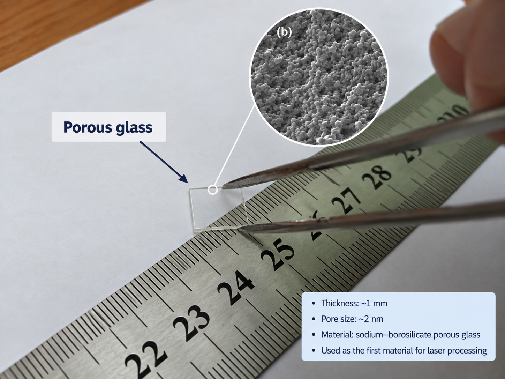
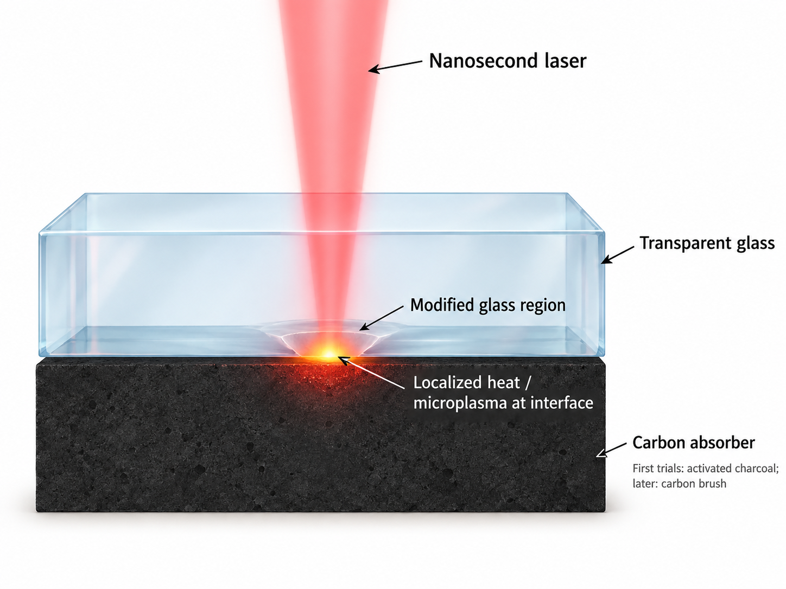

# Glass–carbon origin of laser microplasma processing

> **Summary:** This note explains how the research line began: first with a rough metal-target experiment, then with carbon absorbers that made it possible to modify transparent glass using the nanosecond laser equipment already available in the laboratory.

## The starting question

The problem was practical:

> How can we create a localized energy source, using the pulsed laser equipment available in the laboratory, that can modify a transparent dielectric material?

I was working with nanosecond laser sources and galvanometric scanning systems. Transparent glasses such as fused silica transmit near-infrared light efficiently, so direct absorption is weak under ordinary nanosecond-processing conditions. Instead of forcing the glass itself to absorb the beam, we explored whether an absorbing material placed behind it could convert the laser energy into a localized thermal and plasma-mediated interaction. The glass–graphite geometry was later described in our early publication on laser-induced black-body heating [1].

## The first material: porous glass

My route into the topic began with porous glass during my bachelor-stage work. Porous glass can be macroscopically transparent while containing a connected nanoscale pore network. Its high internal surface area and accessible pores make it useful as a host for molecules and functional species, including in optical sensing [2]. The same accessible pore network also allows interaction with ambient species; adsorption and related chemical changes are central to the aging problem addressed in our porous-glass passivation study [3].

  

<em>Figure 1. Porous glass as the first material in this research story. The photograph shows the macroscopic sample. The SEM inset is a representative porous-glass morphology adapted from Rysiakiewicz-Pasek et al. [4], distributed under CC BY 4.0; it is not presented as an SEM image of the exact sample shown in the photograph.</em>

That led to the first application question:

> Can we densify or seal only the outer surface while preserving the porous structure inside?

The work later published on porous-glass passivation showed that thermally modified surface regions could be produced while the internal porous structure remained [3]. That became the first functional application in this research line and is discussed in [Note 01](01-porous-glass-to-surface-structuring.md).

## Making the laser energy useful for transparent optical materials

The basic problem was that the optical material itself did not absorb enough of the near-infrared nanosecond laser radiation to be modified efficiently. We therefore needed another way to absorb the light and convert it into a local source of energy close to the surface.

An early test used a metal target placed next to the porous glass, with the beam focused at the interface. A large, sub-millimeter-scale cavity formed in the glass surface and was heavily contaminated by material from the target. The result was not suitable as a processing method, but it showed that an absorbing target could transfer enough localized energy to modify the glass.

The next step was to use carbon-based absorbers. With the transparent sample in contact with graphite or carbon, the laser beam passed through the optical material and was absorbed by the target. That absorption produced intense local heating, target ablation and microplasma at the interface, and the released energy then acted back on the adjacent transparent material and modified its surface [1].

The carbon target was therefore not the object being processed. It acted as the absorber that converted the incident laser radiation into a localized energy source at the glass interface.

<table>
<tr>
<td width="55%" valign="top">

laser passes through the transparent optical material  
→ carbon/graphite absorbs the radiation  
→ localized heating, ablation and microplasma develop at the interface  
→ the released energy modifies the adjacent optical material

</td>
<td width="45%" valign="top" align="center">
   
  <em>Figure 2. The carbon target absorbs the laser radiation and converts it into a localized high-energy interaction that modifies the adjacent transparent optical material.</em>
</td>
</tr>
</table>

> **Early absorber trials.** I remember starting with very simple materials, including activated charcoal, before moving to more compact carbon absorbers such as carbon brushes.

The geometry was attractive because it was simple and compatible with the nanosecond-laser hardware already available. It did not require a photomask, deposited absorbing film or ultrashort-pulse source.

## From an interaction to a processing method

Once the glass–target interaction could be reproduced, the next questions were practical:

- Could the process densify porous glass without destroying the internal pore network?
- Could it modify dense fused silica without cracking?
- Could the relief depth be controlled over the micrometer range?
- Could repeated scanning create useful arrays and phase structures?
- Which part of the effect came from thermal transfer, target ablation, plasma pressure or material transfer?

The next studies addressed these questions step by step, moving from porous-glass stabilization toward controlled surface structuring and functional micro-optics. One early step in that transition was the demonstration of fast surface microstructuring of silica glasses [5].

## Where the story goes next

The first practical application was porous-glass passivation. The next stage was to test whether the same target-assisted interaction could be used for controlled structuring of dense glass and, eventually, for fabrication of functional micro-optical elements.

Continue with [Note 01 — porous-glass sealing and passivation](01-porous-glass-to-surface-structuring.md), or return to the [research map](../research-map.md).

## References

1. **R. A. Zakoldaev**, M. M. Sergeev, G. K. Kostyuk, V. P. Veiko, “Laser-induced Black-body Heating (LIBBH) as a Method for Glass Surface Modification,” *Journal of Laser Micro/Nanoengineering* 10 (2015), 15–19. https://doi.org/10.2961/jlmn.2015.01.0003
2. X.-D. Wang, O. S. Wolfbeis, “Optical methods for sensing and imaging oxygen: materials, spectroscopies and applications,” *Chemical Society Reviews* 43 (2014), 3666–3761. https://doi.org/10.1039/C4CS00039K
3. M. M. Sergeev, G. K. Kostyuk, **R. A. Zakoldaev**, E. B. Yakovlev, “Laser-induced passivation of porous glass to protect it from chemical degradation and aging,” *Protection of Metals and Physical Chemistry of Surfaces* 51 (2015), 427–434. https://doi.org/10.1134/S207020511503020X
4. E. Rysiakiewicz-Pasek, T. Antropova, I. Polyakova, O. Pshenko, A. Ciżman, “New Insight into Phase Transitions of Porous Glass-Based Ferroelectric Nanocomposites,” *Materials* 13 (2020), 3698. https://doi.org/10.3390/ma13173698 — source of the representative SEM inset in Figure 1; CC BY 4.0.
5. G. K. Kostyuk, M. M. Sergeev, **R. A. Zakoldaev**, E. B. Yakovlev, “Fast microstructuring of silica glasses surface by NIR laser radiation,” *Optics and Lasers in Engineering* 68 (2015), 16–24. https://doi.org/10.1016/j.optlaseng.2014.12.004
