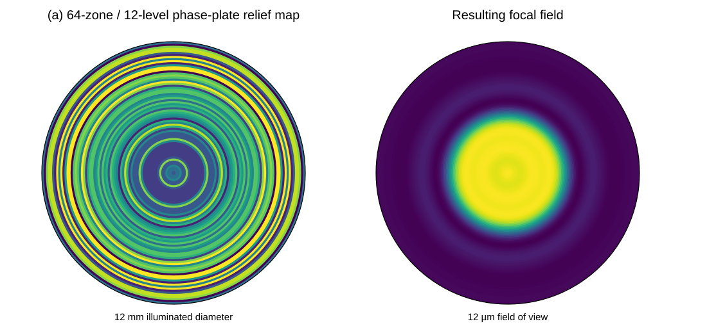
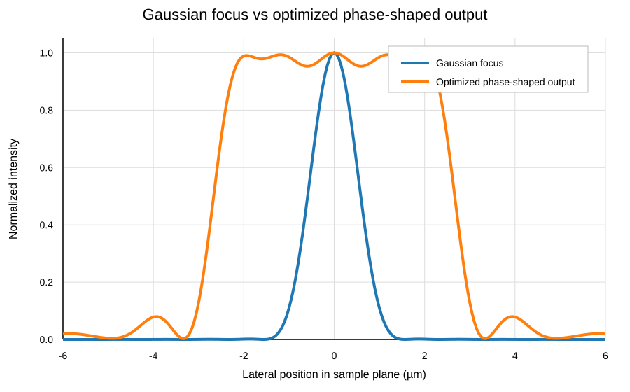

# 01 — From beam correction to a Raman micro-probe

In 2017 we used laser-induced microplasma processing to fabricate multilevel phase plates directly in fused silica. The goal then was beam homogenization. A five-level plate reduced the measured intensity modulation relative to a binary plate, and the process demonstrated relief control on the order of tens of nanometres.

Reference: R. A. Zakoldaev *et al.*, “Fast Fabrication of Multilevel Phase Plates Used for Laser Beam Correction,” *Journal of Laser Micro/Nanoengineering* 12 (2017), 281–285. [DOI](https://doi.org/10.2961/jlmn.2017.03.0018)

Looking at that result now, I would use the same fabrication capability for a different problem: **making Raman excitation less sensitive to where a particle crosses the focus in a microfluidic channel.**

## The problem

A Gaussian focus gives high peak intensity, but the excitation changes rapidly with lateral position. Two nominally identical particles following slightly different trajectories can therefore produce different Raman amplitudes even if their composition is the same.

For flow measurements, a better probe may be one with a small flat central region and smooth edges. The aim is not maximum peak intensity; it is a more reproducible excitation volume.

## What I would fabricate now

I would not use a random phase plate. I would use a deterministic multilevel annular relief designed for a soft top-hat output.

The current numerical example uses:

```text
wavelength:                785 nm
input beam diameter:       12 mm
objective NA:              0.40
annular zones:             64
phase/depth levels:        12
zone width:                ~100 µm
nominal depth step:        ~140 nm
flat-core diameter:        ~4.2 µm
useful probe diameter:     ~6 µm
```

The soft edge is important. Forcing a sharp top-hat produced strong radial ringing in the first simulations. Giving the field a smooth roll-off made it possible to keep the central region flat while retaining useful energy and limiting the ringing outside it.



*Proposed 64-zone / 12-level phase plate and the corresponding simulated focal field for the current 785 nm example.*

## What the present model gives

For the default 64-zone / 12-level case, the scalar model gives approximately:

```text
energy inside the useful 6 µm probe:  ~0.83
CV inside the flat core:               ~0.011
min/max intensity in the flat core:    ~0.95
```

The optimized output is not a mathematically perfect top-hat. Small ripple remains in the plateau and weak structure remains outside it. The useful result is that the central region becomes much flatter than the Gaussian focus while most of the modeled energy remains in the useful probe.



*Gaussian reference and the actual optimized phase-shaped output. Each profile is normalized to its own peak to compare the shapes directly.*

These values are **simulation outputs, not experimental measurements**.

### A practical power comparison

Suppose the Raman source is a **785 nm single-mode laser delivering 100 mW** into the modeled optical system. In the present calculation, about 99% of the Gaussian-beam power and about 83% of the shaped-beam power fall inside the same 6 µm-diameter useful region.

That corresponds to an average power density of roughly **350 kW/cm²** for the Gaussian case and **290 kW/cm²** for the shaped case, averaged over the 6 µm-diameter disk.

So the shaped beam does not need orders of magnitude more laser power to recover the same average excitation density. In this model, increasing the source from **100 mW to about 120 mW** would compensate for the redistributed power and bring the average power density in the useful region back to approximately the Gaussian value.

This is different from matching the sharp on-axis Gaussian peak. The purpose of the phase plate is precisely to trade some peak intensity for a broader and more uniform excitation region.

## Why this is interesting

A permanent fused-silica element has no moving parts, needs no active control and can sit directly in a fixed optical train. For a microfluidic Raman system, the practical question is whether this flatter probe reduces event-to-event variation enough to compensate for the lower peak intensity compared with a Gaussian focus.

The metric I would test is therefore not only Raman intensity, but

\[
\frac{\sigma(S)}{\langle S\rangle},
\]

for nominally identical particles under controlled flow.

## Next experiment

The next step is straightforward: fabricate the optimized relief, measure the real surface profile, image the focal field, and compare Raman burst distributions from the same particle suspension with and without the phase plate.

The Python script is meant to be more than a record of this one example. It can serve as a small design tool: change the beam, numerical aperture, number of zones, number of depth levels or requested output profile, rerun it, and generate a new candidate plate before fabrication.

Reproducible code and proposed input parameters are in [`simulations/raman-flat-top`](../simulations/raman-flat-top/README.md).
